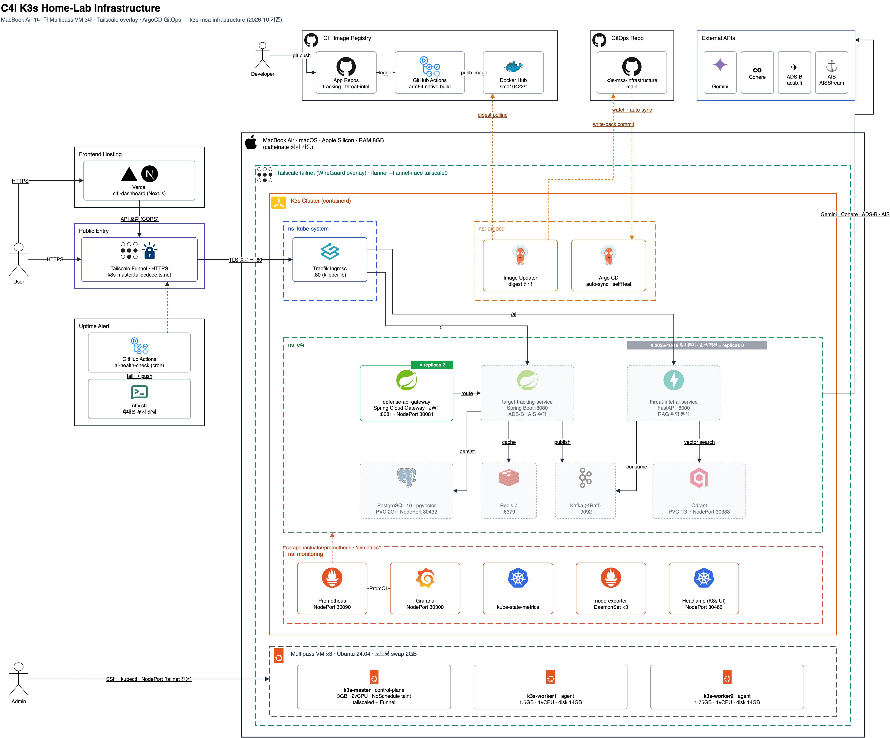

# 🛡️ C4I 실시간 전술 객체 추적 시스템 - 인프라스트럭처 (K3s MSA)

  

## 📌 프로젝트 개요
본 리포지토리는 **실시간 전술 객체(드론, 항공기 등) 추적 및 데이터 시각화 MSA 시스템**을 구동하기 위한 **고가용성(HA) 로컬 쿠버네티스 클러스터 인프라** 구성 및 배포 명세(IaC)를 담고 있습니다. 

국방/방산 도메인에서 요구하는 '중단 없는 서비스(고가용성)'와 '안전한 내부 통신망(보안)'을 로컬 환경에 완벽하게 모사하는 것을 목표로 설계되었습니다.

## 🏗️ 아키텍처 및 클러스터 구성

*MacBook Air 위 Multipass VM 3대를 Tailscale overlay로 묶은 K3s 클러스터와, GitHub Actions → Docker Hub → ArgoCD Image Updater → GitOps 리포로 이어지는 배포 흐름입니다. (원본: [`docs/diagram/k3s-infra-architecture.drawio`](docs/diagram/k3s-infra-architecture.drawio))*

제한된 호스트 자원(MacBook Air, RAM 8GB) 내에서 최적의 분산 환경을 구축하기 위해, 무거운 Docker 대신 `containerd` 기반의 경량화 쿠버네티스인 **K3s**를 채택하여 Multipass VM 3대로 3-Node 클러스터를 구축했습니다.

| Node Name | Role | OS | vCPU | RAM | Disk | Swap Memory | Network (VPN) |
| :--- | :--- | :--- | :--- | :--- | :--- | :--- | :--- |
| **`k3s-master`** | `Control-plane` (`NoSchedule` taint) | Ubuntu 24.04 | 2 | 3GB | 12GB | 2GB (OOM 방어) | Tailscale IP (`100.x.x.x`) · Funnel |
| **`k3s-worker1`** | `Worker` (Agent) | Ubuntu 24.04 | 1 | 1.5GB | 14GB | 2GB (OOM 방어) | Tailscale IP (`100.x.x.x`) |
| **`k3s-worker2`** | `Worker` (Agent) | Ubuntu 24.04 | 1 | 1.75GB | 14GB | 2GB (OOM 방어) | Tailscale IP (`100.x.x.x`) |

## ✨ 인프라 핵심 엔지니어링 포인트

### 1. 망 분리 및 보안 통신망 구축 (VPC 모사)
* **Tailscale**을 도입하여 3대의 가상머신을 안전한 가상 사설망(VPN)으로 묶었습니다.
* K3s 클러스터 내부 통신(`--flannel-iface tailscale0`)을 이 가상망으로만 제한하여, 외부의 접근을 차단하는 국방 망 분리 시스템의 기초적인 형태를 모사했습니다.

### 2. 하드웨어 한계 극복 및 안정성(Stability) 확보
* **메모리 최적화:** `kubeadm` 대신 **K3s**를 도입하여 마스터 노드의 기본 메모리 점유율을 50% 이하(약 900MB)로 다이어트했습니다.
* **OOM(Out Of Memory) 방어막:** VM 램(1.5~3GB)의 한계로 인해 파드(Pod)가 죽는 현상을 방지하고자, 각 노드 디스크에 **2GB의 Swap 메모리를 영구 할당**(`/etc/fstab` 등록)하여 시스템 다운타임을 원천 차단했습니다.

### 3. 워크로드 분산 배치 및 외부 노출
* **컨트롤 플레인 격리:** `k3s-master`에 `NoSchedule` taint를 걸어, 앱 워크로드는 `k3s-worker1`·`k3s-worker2`에만 배치되도록 했습니다.
* **메모리 경합 분산:** `podAntiAffinity`(required)로 메모리를 많이 쓰는 파드끼리 같은 노드에 뜨지 않게 했습니다. `target-tracking-service`와 Kafka를 서로 다른 노드에 두고, `threat-intel-ai-service`·Qdrant는 `target-tracking-service`·PostgreSQL·Redis가 있는 노드를 피해 배치됩니다.
* **고정 진입점 (Traefik Ingress):** K3s 내장 `Traefik`에 Ingress 규칙(`/` → `target-tracking-service`, `/ai` → `threat-intel-ai-service`)을 두어, 파드가 어느 노드로 재스케줄되든 세 노드의 Tailscale IP 중 아무 곳의 80번 포트로 접속할 수 있습니다.
* **공인 인터넷 노출 (Tailscale Funnel):** `k3s-master`의 Tailscale Funnel이 Traefik 80번 포트를 `*.ts.net` HTTPS 주소로 공개합니다. 포트포워딩이나 별도 도메인·인증서 관리 없이 TLS가 자동 적용되며, Grafana·Prometheus 등 NodePort 서비스는 tailnet 내부에서만 접근할 수 있습니다.

## 📂 리포지토리 구성 안내
본 인프라 위에서 동작하는 마이크로서비스(MSA) 코드는 역할에 따라 아래 리포지토리로 분리되어 있습니다.
* 🚪 **[Defense API Gateway (defense-api-gateway) 바로가기](https://github.com/sm010422/defense-api-gateway)** - 보안 인증 및 트래픽 라우팅
* 🎯 **[Target Tracking Service (target-tracking-service) 바로가기](https://github.com/sm010422/target-tracking-service)** - 실시간 레이더 데이터 수집 및 분석 처리
